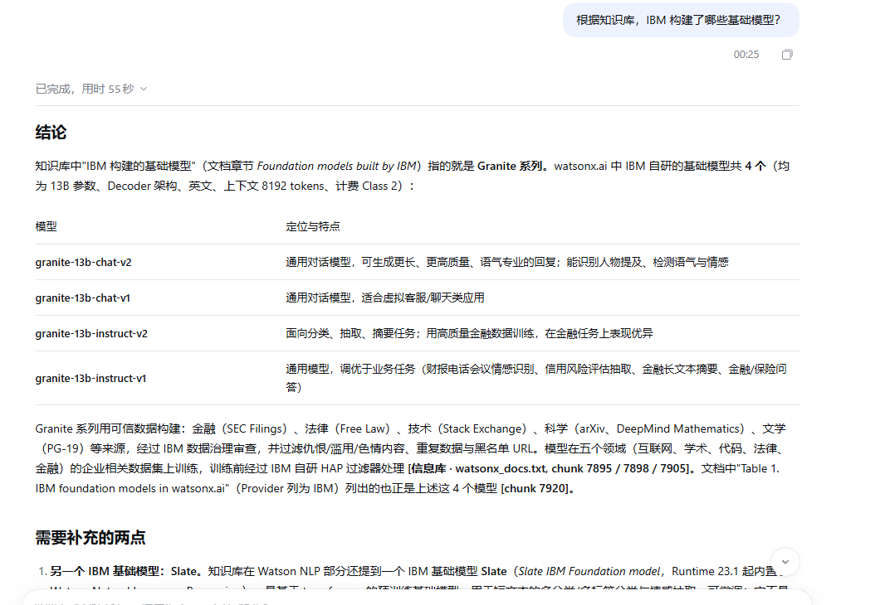

# watsonx 知识库 RAG 助手

> 基于 **DeepSeek Harness** 与 **dsh-knowledge** 插件搭建的个人知识库检索增强生成（RAG）问答助手，
> 知识源为 IBM watsonx 官方文档数据集 **watsonxDocsQA**。

---

## 项目简介

本项目把分散的 IBM watsonx 官方文档整理成一份可检索、可问答的本地知识库。

原始文档被导入到 DeepSeek Harness 的 `dsh-knowledge` 插件中，经过切分与向量化后持久化为本地向量库；
提问时，助手先做语义检索定位相关原文片段，再由大模型基于这些片段生成答案，从而缓解大模型的
知识滞后与幻觉问题，并让每个回答都能追溯到文档来源。

整个流程在本地完成，适合个人学习、技术文档速查以及对数据不外传有要求的场景。

## 核心功能

- **文档导入与切分**：将 `watsonx_docs.txt` 中的长篇官方文档按章节切分为语义段落。
- **向量化与本地持久化**：段落向量写入本地 ChromaDB 向量库（`chroma_db/`），一次构建、重复使用。
- **语义检索问答**：用自然语言提问，先召回最相关的文档片段，再生成有依据的回答。
- **来源可追溯**：回答附带命中的原文内容，便于人工核对，降低幻觉风险。
- **增量维护**：新增或更新文档后重新构建索引即可，知识库可持续演进。
- **隐私友好**：会话状态、密钥与向量库均被 `.gitignore` 排除，不会随仓库外泄。

## 技术栈

| 层次 | 选型 | 说明 |
| --- | --- | --- |
| 运行宿主 | **DeepSeek Harness（DSH）** | 提供会话、工具调用与模型接入的本地运行时 |
| 知识库插件 | **dsh-knowledge** | 负责文档导入、切分、向量化与检索问答 |
| 知识源 | **watsonxDocsQA** | IBM watsonx 官方文档数据集，共 1,144 篇 |
| 向量存储 | ChromaDB | 本地持久化目录 `chroma_db/`（不入库） |
| 答案生成 | DeepSeek 模型 | 由 DSH 配置的对话模型，基于召回片段作答 |
| 版本管理 | Git / GitHub | 仅托管文档、配置与说明文件 |

## 数据集说明

`watsonx_docs.txt` 为本次导入的知识源：

| 项目 | 数值 |
| --- | --- |
| 文件大小 | 约 4.64 MB |
| 总行数 | 68,238 行 |
| 文档篇数 | 1,144 篇 |
| 语言 | 英文 |
| 分隔格式 | 每篇以 `--- Document N ---` 开头，下一行为标题 |

内容主题覆盖 IBM watsonx / Watson Machine Learning / Decision Optimization 等产品文档，例如
Decision Optimization 的 Java 与 Python 建模、notebook 环境与运行时、experiment 与 scenario、
OPL / CPLEX 参考手册，以及模型部署与数据源接入等。

## 目录结构

```
.
├── README.md             # 项目说明（本文件）
├── .gitignore            # 忽略本地状态、密钥与向量库
├── watsonx_docs.txt      # 知识源数据集（watsonxDocsQA，1,144 篇文档）
└── screenshots/          # 运行效果截图
    └── qa_result.png     # RAG 问答实测效果图
```

> `screenshots/qa_result.png` 为实测问答效果图，已随仓库一并托管。

## 本地运行步骤

### 前置条件

- 已安装 **DeepSeek Harness** 客户端并能正常启动。
- 已安装并启用 **dsh-knowledge** 插件。
- 本地磁盘留有足够空间用于存放向量库。

### 步骤

1. **获取项目**

   ```bash
   git clone <your-repo-url>
   cd docs
   ```

2. **确认数据集就位**

   ```bash
   ls -lh watsonx_docs.txt
   ```

   应看到约 4.64 MB 的数据文件；如缺失，请重新从 watsonxDocsQA 数据集导出。

3. **启用 dsh-knowledge 插件**

   在 DeepSeek Harness 中打开插件面板，确认 `dsh-knowledge` 处于已启用状态。
   首次使用需按插件指引完成初始化。

4. **导入数据集并构建索引**

   在 dsh-knowledge 中新建一个知识库，选择项目根目录下的 `watsonx_docs.txt` 作为数据源，
   执行导入：插件会完成文档切分与向量化，并在本地生成 `chroma_db/` 向量库目录。
   1,144 篇文档的首次构建需要一定时间，请等待进度完成。

   > 不同版本的插件入口名称可能略有差异，以你本地安装的版本为准。

5. **验证问答**

   选择刚构建的知识库发起提问，例如：

   - `How do I create and run Decision Optimization models in Java?`
   - `Which Python runtimes include the full CPLEX commercial edition?`
   - `What data sources are supported in Decision Optimization?`

   若回答能够引用 `watsonx_docs.txt` 中的对应段落，说明检索与生成链路正常。

6. **保存运行截图**

   将实测截图保存为 `screenshots/qa_result.png`，即可在下方「运行效果」中展示。

## 运行效果

下图为导入 watsonxDocsQA 数据集后进行 RAG 问答的实测界面：提问「根据知识库，IBM 构建了哪些基础模型？」，
助手基于检索到的文档片段给出结论与模型对比表，并标注来源分块（`watsonx_docs.txt` chunk 7895 / 7898 / 7905、chunk 7920）。



## 安全与隐私

`.gitignore` 已排除以下内容，避免敏感数据与可重建产物进入版本库：

| 忽略项 | 原因 |
| --- | --- |
| `.dsh/` | DSH 本地会话、附件等运行状态 |
| `.env`、`.env.*` | 环境变量，可能包含访问令牌 |
| `*.key` | 各类密钥文件 |
| `chroma_db/` | 向量库，可由数据集本地重建 |
| `*.db` | 本地数据库文件 |

## 后续计划

- 持续补充实测问答截图，覆盖更多典型问题。
- 扩充中文技术文档，构建中英混合知识库。
- 优化切分粒度与召回条数，提升长文档问答准确率。
- 沉淀典型问答样例，形成可回归的评测集。

## 许可

个人学习与研究用途。`watsonx_docs.txt` 内容版权归 IBM 所有，仅作本地知识库检索使用。
